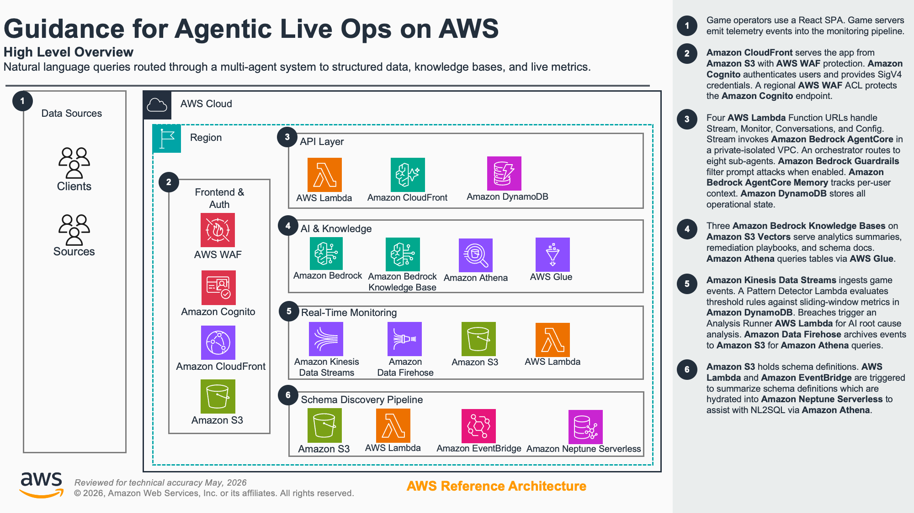

# Guidance for Agentic Live Ops on AWS

## Table of Contents

1. [Overview](#overview)
    - [Architecture](#architecture)
    - [Cost](#cost)
2. [Prerequisites](#prerequisites)
    - [Operating System](#operating-system)
    - [Third-party tools](#third-party-tools)
    - [AWS account requirements](#aws-account-requirements)
    - [aws cdk bootstrap](#aws-cdk-bootstrap)
    - [Supported Regions](#supported-regions)
3. [Deployment Steps](#deployment-steps)
4. [Deployment Validation](#deployment-validation)
5. [Running the Guidance](#running-the-guidance)
    - [Chat interface](#chat-interface)
    - [Real-time monitoring](#real-time-monitoring)
    - [Schema discovery](#schema-discovery)
6. [Security Considerations](#security-considerations)
7. [Next Steps](#next-steps)
8. [Cleanup](#cleanup)
9. [Notices](#notices)
10. [Authors](#authors)

## Overview

An AI-powered operational analytics solution that turns high-volume telemetry data into conversational insights. Users ask natural language questions and get back data-driven answers with charts, tables, and citations, streamed in real time.

The solution is built around a multi-agent architecture running on Amazon Bedrock AgentCore. An orchestrator routes queries to specialized agents, each with access to three data tiers: a knowledge base for pre-computed summaries, Athena for SQL against structured historical data, and DynamoDB for live sliding-window metrics.

A real-time monitoring pipeline ingests events via Kinesis, detects anomalies using configurable threshold rules, and triggers AI-powered root cause analysis automatically. An Amazon Data Firehose delivery stream archives all raw game events to S3 in parallel, making them queryable via Athena for historical analysis.

A schema discovery pipeline lets operators onboard new data sources without code changes. Upload raw schema files (SQL DDL, JSON, YAML, or free-form text) to S3, and an LLM-powered agent generates standardized documentation. A daily hydration job syncs this metadata into a Neptune Serverless graph database and a dedicated Bedrock Knowledge Base, giving agents awareness of table relationships and multi-hop join paths at query time.

Everything runs serverless on AWS and deploys as three CDK stacks from a single command. Branding, agent models, and table schemas are all config-driven via `cdk.json`. No code changes are needed to adapt the solution to a different domain.

For a detailed technical deep dive, see [docs/architecture.md](docs/architecture.md).

### Architecture



### Cost

_You are responsible for the cost of the AWS services used while running this Guidance. As of May 2026, the cost for running this Guidance with the default settings in the US West (Oregon) Region is approximately $370 per month for processing 1,500 AI queries and 6.5 million telemetry events._

_We recommend creating a [Budget](https://docs.aws.amazon.com/cost-management/latest/userguide/budgets-managing-costs.html) through [AWS Cost Explorer](https://aws.amazon.com/aws-cost-management/aws-cost-explorer/) to help manage costs. Prices are subject to change. For full details, refer to the pricing webpage for each AWS service used in this Guidance._

| Scenario     | Users | AI queries / month | Monthly cost |
| ------------ | ----- | ------------------ | ------------ |
| POC demo     | 5     | 1,500              | ~$370        |
| Small studio | 15    | 15,000             | ~$1,370      |

For a full breakdown by service, pricing assumptions, and references, see [docs/cost-estimate.md](docs/cost-estimate.md).

## Prerequisites

### Operating System

This Guidance has been tested on macOS and Amazon Linux 2023. Deployment on Windows requires WSL2.

### Third-party tools

Install the following before deploying:

- [Node.js](https://nodejs.org/) 22.8.0 or later, and npm
- [Docker](https://www.docker.com/) (must be running at synth/deploy time; CDK builds Python Lambda layers in containers)
- [Python](https://www.python.org/) 3.12 or later
- [AWS CDK CLI](https://docs.aws.amazon.com/cdk/v2/guide/cli.html) 2.1117.0 or later
- [AWS CLI](https://docs.aws.amazon.com/cli/latest/userguide/getting-started-install.html) v2, configured with credentials for the target account

Optional:

- [uv](https://docs.astral.sh/uv/) for faster Python dependency management. If `uv` is not installed, the npm `postinstall` hook prints a note and skips gracefully. You can install Python dependencies manually with `pip install -r requirements.txt` in the relevant directories.

### AWS account requirements

Your AWS account must have access to the following Amazon Bedrock models in the deployment region:

| Model                                         | Used by                                                                         |
| --------------------------------------------- | ------------------------------------------------------------------------------- |
| `us.anthropic.claude-sonnet-4-6`              | Orchestrator agent                                                              |
| `us.anthropic.claude-haiku-4-5-20251001-v1:0` | All sub-agents, schema discovery agent, incident analysis, knowledge base query |
| `amazon.titan-embed-text-v2:0`                | Knowledge base embeddings                                                       |

The two Claude model IDs are cross-region inference profiles. They require Bedrock model access in the corresponding profile regions (typically the `us.*` regions for the US profile).

### aws cdk bootstrap

If you are using AWS CDK for the first time in the target account and region, bootstrap the environment:

```bash
npm run cdk -- bootstrap
```

See the [Bootstrapping](https://docs.aws.amazon.com/cdk/v2/guide/bootstrapping.html) section of the AWS CDK developer guide for details.

### Supported Regions

Deploy to a region where both Amazon Bedrock AgentCore and Amazon S3 Vectors are available. The default configuration targets `us-west-2`.

- [Amazon Bedrock AgentCore regions](https://docs.aws.amazon.com/bedrock-agentcore/latest/devguide/agentcore-regions.html)
- [Amazon S3 Vectors regions and quotas](https://docs.aws.amazon.com/AmazonS3/latest/userguide/s3-vectors-regions-quotas.html)

The stacks resolve the region from your AWS credentials, so deploying elsewhere requires no code changes. Four helper scripts hardcode `us-west-2` and need updating to match:

- `scripts/hydrate-athena.py` (`REGION` constant)
- `scripts/kb-eval/evaluate_kb.py` (`REGION` constant)
- `scripts/agent-eval/evaluate_agents.py` (`REGION` constant)
- `scripts/agent-eval/evaluate_data_paths.py` (`REGION` constant)
- `scripts/push-kinesis-events.py` (`--region` argument default)

## Deployment Steps

1. Clone the repository:

    ```bash
    git clone https://github.com/aws-solutions-library-samples/guidance-for-agentic-live-ops-on-aws.git
    cd guidance-for-agentic-live-ops-on-aws
    ```

2. Install dependencies:

    ```bash
    npm install
    ```

3. Ensure your AWS CLI is configured with credentials for the target account and region:

    ```bash
    aws sts get-caller-identity
    ```

    CDK deploys to whichever account and region your CLI credentials resolve to.

4. Make sure Docker is running, then bootstrap CDK (first time only):

    ```bash
    npm run cdk -- bootstrap
    ```

5. Deploy all stacks:

    ```bash
    npm run cdk -- deploy "dev/*"
    ```

    This deploys three stacks: `dev-liveops-frontend`, `dev-liveops-backend`, and `dev-liveops-frontendDeployment`. The first deploy takes approximately 25-30 minutes. Subsequent deploys are much faster.

6. Hydrate the Athena seed data:

    ```bash
    npm run hydrate-athena -- --stage dev
    ```

7. Create a Cognito user. Open the [Amazon Cognito console](https://console.aws.amazon.com/cognito/v2/idp/user-pools), select the user pool created by the `dev-liveops-backend` stack, and create a user with a valid email address.

## Deployment Validation

1. Open the [AWS CloudFormation console](https://console.aws.amazon.com/cloudformation/home) and verify all three stacks show `CREATE_COMPLETE`:
    - `dev-liveops-frontend`
    - `dev-liveops-backend`
    - `dev-liveops-frontendDeployment`

2. Find the CloudFront distribution URL in the `dev-liveops-frontend` stack outputs. Open it in a browser and confirm the login page loads.

3. Open the [Amazon Bedrock AgentCore console](https://console.aws.amazon.com/bedrock-agentcore) and verify the agent runtime status is `ACTIVE`.

## Running the Guidance

### Chat interface

1. Log in with the Cognito user you created during deployment.
2. Type a question in the chat input (for example: "What are the top 5 revenue-generating characters this week?").
3. Observe the agent activity feed on the left showing which sub-agent was selected, the data tier queried, and the reasoning steps.
4. The response streams in real time with charts, tables, and source citations.
5. Use the question selector (lightbulb icon) to browse pre-built analytics questions organized by category.

### Real-time monitoring

1. Push test events to the Kinesis stream:

    ```bash
    python scripts/push-kinesis-events.py \
      --stream-name <STREAM_NAME> \
      --scenario spike \
      --count 500
    ```

    Find the stream name in the `GameEventStreamName` output of the `dev-liveops-backend` stack. The demo heartbeat is enabled by default in `cdk.json` and already generates a baseline event flow, so the Monitor page shows activity without pushing events manually. Set `demoHeartbeat.enabled` to `false` and redeploy to disable it.

2. Open the Monitor page (`/monitor`) in the UI. KPI cards, event timeline, and live metric gauges update as events flow in.

3. When event rates exceed a threshold rule, the Analysis Runner triggers automatically. AI-generated incident reports appear in the Reports section with severity, root cause, and remediation recommendations.

4. Click "Investigate in Chat" on any report to send it to the chat interface for deeper analysis.

### Schema discovery

1. Upload a raw schema file (SQL DDL, JSON, YAML, or free-form text) to the schema ingest S3 bucket (find the bucket name in the `dev-liveops-backend` stack outputs).

2. The Schema Agent Lambda processes the file and generates standardized markdown documentation in the schema docs bucket.

3. After the daily hydration job runs (or trigger it manually), agents can discover the new tables using `search_schema` and `find_join_path` tools in chat queries.

## Security Considerations

The default configuration favors quick setup for evaluation. Review and harden the following before deploying to production:

- **Multi-factor authentication (MFA).** The Cognito user pool does not require MFA, so that demo users can sign in quickly. For production, require MFA by setting `mfa: Mfa.REQUIRED` on the user pool in `lib/stacks/backend/constructs/auth.ts`.
- **WAF is in monitor-only mode.** Several WAF managed rules (the Common rule set, Bot Control, and the `SQLi_BODY` and `UNIXShellCommandsVariables_BODY` rules) are set to count mode in `lib/stacks/backend/constructs/auth.ts`. Count mode logs matches but does not block them. This avoids false positives, since the chat legitimately carries SQL-like and shell-like text. For production, review whether these rules should be switched to block mode after confirming that normal traffic, including chat payloads, is not caught.
- **Bedrock model invocation uses a wildcard resource.** The AgentCore runtime (`lib/stacks/backend/constructs/agents/index.ts`) and the analysis runner (`lib/stacks/backend/constructs/realtime-monitor/index.ts`) grant `bedrock:InvokeModel` on all resources, so any model configured in `cdk.json` works without changes. For production, scope these policies to the specific foundation-model and inference-profile ARNs in use, as done in `lib/stacks/backend/constructs/schema-discovery/pipeline.ts`.

## Next Steps

- **Customize for your domain.** Change `branding.appTitle`, `branding.domainLabel`, and `analytics.tables` in `cdk.json` to point at your own data. No code changes required.
- **Add new agents.** Create a folder in `data/agent-configs/` with a `config.json` and `prompt.md`, then redeploy. The Agent Factory picks up new agents automatically.
- **Connect real telemetry.** Point your game servers or event pipeline at the Kinesis stream to replace the synthetic test data.
- **Regenerate KB summaries.** After updating seed data, run `python scripts/generate_kb_summaries.py` to refresh the Knowledge Base.
- **Run evaluations.** Use the built-in eval scripts to measure agent accuracy and KB retrieval quality:

    ```bash
    npm run eval:agents -- --stage dev --action full --limit 5
    npm run eval:kb -- --stage dev
    ```

For architecture details, data flows, and implementation internals, see [docs/architecture.md](docs/architecture.md).

| Guide                                                    | Description                                              |
| -------------------------------------------------------- | -------------------------------------------------------- |
| [Architecture Deep Dive](docs/architecture.md)           | Multi-agent system, data tiers, infrastructure details   |
| [Cost Estimate](docs/cost-estimate.md)                   | Approximate AWS service cost breakdown                   |
| [Schema Discovery Guide](docs/schema-discovery-guide.md) | Onboarding new data schemas via the LLM-powered pipeline |
| [Evaluation Guide](docs/evaluation-guide.md)             | KB and agent evaluation setup and result interpretation  |
| [Adding Agents](docs/adding-agents.md)                   | Creating and configuring new sub-agents                  |
| [Agent Debugging](docs/agent-debugging.md)               | Tracing agent behavior and reading CloudWatch logs       |
| [Agent Response Formats](docs/agent-response-formats.md) | Chart, table, and citation output contracts              |
| [Working with Kiro](docs/working-with-kiro.md)           | Using Kiro and the bundled MCP servers on this repo      |

## Cleanup

Destroy all deployed stacks:

```bash
npm run cdk -- destroy "dev/*"
```

This deletes the S3 buckets and their contents, the Neptune cluster, and the DynamoDB tables.

The Cognito user pool is retained. Delete it from the [Amazon Cognito console](https://console.aws.amazon.com/cognito/v2/idp/user-pools) if you want a full cleanup.

## Notices

_Customers are responsible for making their own independent assessment of the information in this Guidance. This Guidance: (a) is for informational purposes only, (b) represents AWS current product offerings and practices, which are subject to change without notice, and (c) does not create any commitments or assurances from AWS and its affiliates, suppliers or licensors. AWS products or services are provided "as is" without warranties, representations, or conditions of any kind, whether express or implied. AWS responsibilities and liabilities to its customers are controlled by AWS agreements, and this Guidance is not part of, nor does it modify, any agreement between AWS and its customers._

## Authors

- [Armando Vargas](https://github.com/armandocv)
- Patrick Santora
