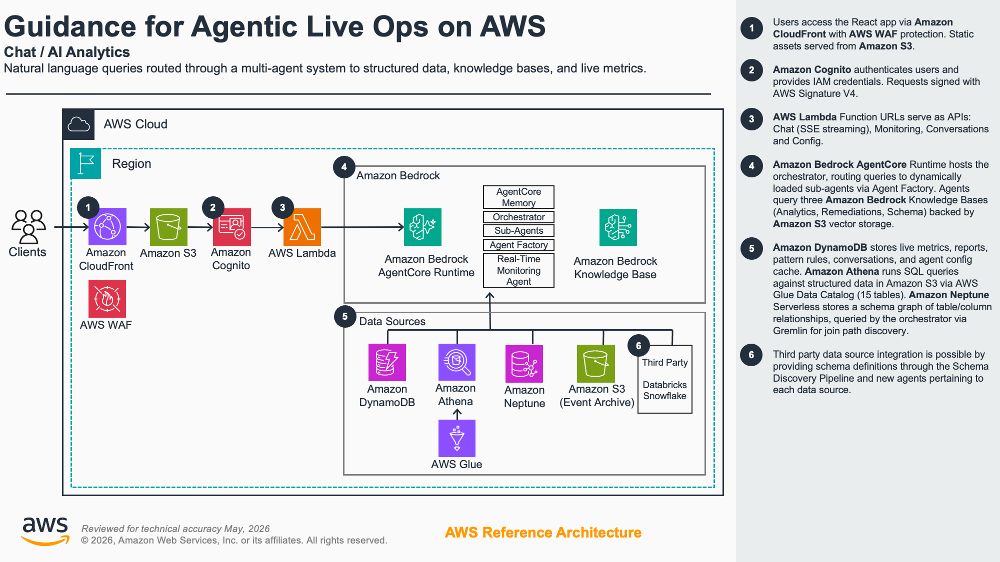
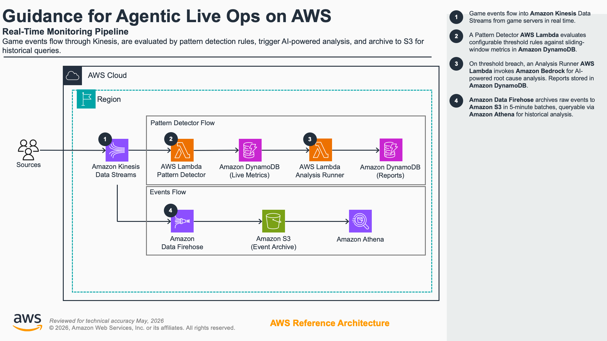
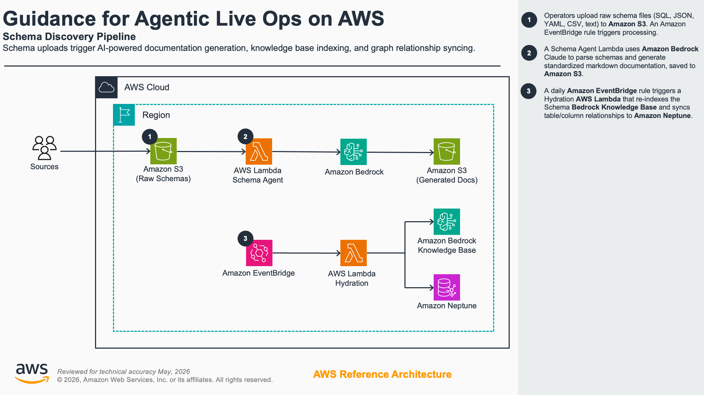

# Architecture Deep Dive

This document covers the internal architecture, data flows, and implementation details of the Agentic Live Ops solution. For deployment instructions, see the [README](../README.md).

## What It Does

### Chat / AI Analytics



Users ask natural language questions about player behavior, revenue, engagement, and operations. The orchestrator routes each question to the most relevant specialized agent, which queries the appropriate data tier and streams a response back with reasoning steps and source citations visible in real time. Conversation history persists across sessions via AgentCore Memory.

For example prompts organized by agent and use case, open the question selector in the chat UI. The catalog is maintained in `lib/stacks/frontend/app/src/components/question-selector/question-parser.ts`.

### AgentCore Multi-Agent System

The agent runtime runs on Amazon Bedrock AgentCore with a config-driven multi-agent architecture. An orchestrator routes queries to specialized sub-agents that are dynamically loaded from configuration rather than hardcoded.

**Dynamic Agent Configuration.** Sub-agents are defined as individual folders in `data/agent-configs/` (each with `config.json` + `prompt.md`) and deployed to an S3 bucket at CDK synth time. The Agent Factory scans S3 on startup, caches configs in a DynamoDB table with a 30-minute TTL, and creates `@tool` functions dynamically.

A Config API (Lambda Function URL with IAM auth) provides CRUD endpoints for managing agent configs at runtime. Operators can add, modify, disable, or remove agents without redeploying.

**Default Agents**

| Agent                    | Tool Sets            | Purpose                                                |
| ------------------------ | -------------------- | ------------------------------------------------------ |
| Performance Metrics      | `athena`             | KPIs, monetization, revenue analysis                   |
| Player Segmentation      | `athena`             | Cohort analysis, whale/dolphin/minnow breakdowns       |
| Player Targeting         | `athena`             | Character targeting, engagement patterns               |
| Trend Analysis           | `athena`             | Behavioral trends and pattern detection over time      |
| Creative Optimization    | `athena`             | Campaign creative performance                          |
| Acquisition Optimization | `athena`             | UA channel ROI, CPI, LTV                               |
| Fact Checking            | `athena`             | Validates claims against actual data                   |
| Incident Response        | `realtime`, `athena` | Historical incident analysis with live anomaly context |

The Real-Time Monitor agent remains hardcoded due to its unique DynamoDB live-metrics access patterns.

**Fallback Behavior.** When no dynamic agents are loaded (empty DynamoDB + no S3 configs), the orchestrator falls back to querying Athena directly using its own query tools, alongside schema discovery tools and the hardcoded Real-Time Monitor agent. When sub-agents are available, the orchestrator delegates data queries to them and does not have direct Athena access.

Each agent has its own model configuration (set in `cdk.json`) and queries three data tiers:

1. **Knowledge Base** (pre-computed markdown summaries in S3 Vectors for fast semantic retrieval)
2. **Athena / Glue** (SQL queries against structured CSV data, table schemas defined in `cdk.json`)
3. **DynamoDB** (live sliding-window metrics from the real-time monitoring pipeline)

Short-term memory (AgentCore Memory, 7-day TTL) carries context across conversation turns. A schema graph (Neptune Serverless, queried via Gremlin) and Schema KB give agents awareness of table relationships and join paths at query time.

### Real-Time Monitor

- Kinesis Data Stream
  A Kinesis-powered event pipeline ingests live game telemetry and detects anomalies against configurable threshold rules:

- Game events flow into a Kinesis stream. A Pattern Detector Lambda updates sliding-window counters in DynamoDB and evaluates rules.
- An Amazon Data Firehose delivery stream reads from the same Kinesis stream in parallel and archives all raw events to S3 as JSON-line files (5-minute batches), making them queryable via the `game_events` Athena table for historical analysis.
- When a threshold is breached, the Analysis Runner Lambda fires asynchronously (with an atomic 1-hour-per-rule cooldown persisted in DynamoDB). A Strands AI agent correlates live metrics with the Knowledge Base and a dedicated Remediations KB (playbooks for common incident types), then writes a report to DynamoDB.
- The Monitor dashboard shows KPI cards, event timeline, live metric gauges, and AI-generated reports with severity, root cause, and remediation recommendations.
- Any report can be sent to the chat interface for deeper investigation.
- Default rules cover: `battle_error`, `session_drop`, `purchase_failure`, `churn_signal`, `api_abuse`.
- DynamoDB live metrics serve real-time queries (last few minutes); Athena `game_events` serves historical queries (hours/days/weeks). The orchestrator prompt prevents agents from querying both for the same question.

### Schema Discovery Pipeline

An LLM-powered pipeline for onboarding new data schemas without code changes:

- Upload raw schema files (SQL DDL, JSON, YAML, free-form text) to S3.
- Schema Agent Lambda sends them to Bedrock Claude, which generates standardized markdown docs per table with TODO markers for human review.
- A daily Hydration Lambda detects updated docs, re-indexes the Schema KB, and syncs the schema graph in Neptune Serverless.
- Agents use `search_schema`, `find_join_path`, `list_table_relationships`, and `resolve_entity` tools to discover tables and columns at query time.

## Project Structure

```
.
├── bin/app.ts                          # CDK app entrypoint
├── cdk.json                            # All deployment config (branding, models, table schemas)
├── lib/
│   ├── stage.ts                        # CDK stage — wires Frontend → Backend → FrontendDeployment
│   ├── common/
│   │   ├── blueprints.ts               # Shared CDK blueprints (logging, retention policies)
│   │   ├── utilities.ts                # Shared CDK utilities
│   │   └── constructs/                 # Reusable L2 constructs (Stack, S3)
│   └── stacks/
│       ├── backend/
│       │   ├── index.ts                # Backend stack — reads cdk.json context, wires all constructs
│       │   └── constructs/
│       │       ├── auth.ts             # Cognito UserPool + IdentityPool + WAF
│       │       ├── database.ts         # DynamoDB tables (events, metrics, reports, rules, conversations)
│       │       ├── knowledge-base.ts   # Bedrock KB (S3 Vectors) + sync Lambda + EventBridge
│       │       ├── networking.ts       # VPC + security groups for AgentCore runtime
│       │       ├── neptune.ts          # Neptune Serverless for schema graph (SSM param export)
│       │       ├── analytics.ts        # Glue catalog + Athena workgroup (tables from cdk.json)
│       │       ├── memory.ts           # AgentCore Memory (7-day TTL)
│       │       ├── agents/
│       │       │   ├── index.ts        # AgentCore Runtime construct + IAM grants
│       │       │   └── runtime/        # Python agent code (deployed as Docker image)
│       │       │       ├── index.py    # Orchestrator + AgentFactory integration (Strands SDK)
│       │       │       ├── agent_factory.py  # Dynamic agent creation from DynamoDB/cdk.json configs
│       │       │       ├── Dockerfile
│       │       │       ├── requirements.txt
│       │       │       ├── common/
│       │       │       │   ├── reasoning_emitter.py  # SSE event emission helpers
│       │       │       │   └── utils.py              # PromptLoader ({{domain}} substitution)
│       │       │       ├── prompts/    # Orchestrator system prompt (sub-agent prompts in data/agent-configs/)
│       │       │       └── tools/
│       │       │           ├── athena_query.py       # query_data tool (Athena SQL)
│       │       │           ├── memory.py             # AgentCore Memory retrieve/store
│       │       │           ├── schema_search.py      # search_schema tool (Schema KB)
│       │       │           ├── schema_graph.py       # find_join_path, list_table_relationships (Neptune Gremlin)
│       │       │           ├── entity_resolution.py  # resolve_entity tool (Neptune entity linking)
│       │       │           └── realtime_monitor.py   # query_live_metrics, get_recent_reports
│       │       ├── api/                # Lambda Function URLs (chat SSE + monitor + conversations + agent config)
│       │       ├── realtime-monitor/   # Kinesis + Firehose + Pattern Detector + Analysis Runner
│       │       ├── demo-heartbeat/     # Optional synthetic event generator
│       │       └── schema-discovery/
│       │           ├── ingest.ts       # S3 buckets for raw schema uploads + generated docs
│       │           ├── pipeline.ts     # Schema Agent Lambda + Hydration Lambda + EventBridge
│       │           └── runtime/        # Python Lambda code for schema processing
│       └── frontend/
│           ├── index.ts                # CloudFront + S3 + WAF + CodeBuild deploy
│           └── app/                    # React application (Vite + TypeScript)
│               └── src/
│                   ├── main.tsx        # Vite entrypoint (Amplify config + React root)
│                   ├── App.tsx         # Router (Chat / Monitor / Login)
│                   ├── pages/
│                   │   ├── Chat/       # Chat page (wraps Chat component + MonitorPanel sidebar)
│                   │   ├── Monitor/    # Full-page monitoring dashboard
│                   │   └── Login/      # Cognito auth page
│                   ├── components/
│                   │   ├── Chat/       # Chat UI, activity feed, sources panel, agents modal
│                   │   ├── Layout/     # TopBar + SideBar (nav + conversation history)
│                   │   ├── MonitorPanel/  # Collapsible sidebar on chat page
│                   │   ├── commons/    # Shared UI components
│                   │   └── question-selector/  # Categorized question browser
│                   ├── common/         # Shared utilities, styles, branding config
│                   ├── hooks/
│                   │   ├── useChat.ts  # SSE streaming hook (normalizes events → MessageParts)
│                   │   └── auth.tsx    # Authentication hook
│                   ├── services/
│                   │   ├── stream-service.ts       # IAM-signed SSE fetch to Lambda Function URL
│                   │   ├── monitor-service.ts      # Monitor API polling
│                   │   └── conversations-service.ts # Conversation persistence API
│                   └── contexts/       # Auth, User, Conversations, Monitor, Flashbar
├── scripts/
│   ├── hydrate-athena.py               # Loads CSV seed data into S3 for Athena
│   ├── push-kinesis-events.py          # Synthetic event generator for testing monitor pipeline
│   ├── generate_kb_summaries.py        # Generates pre-computed KB summary documents
│   ├── agent-eval/                     # Agent and data path evaluation scripts
│   └── kb-eval/                        # Knowledge base evaluation scripts
└── data/
    ├── athena-seed-data/               # CSV files for the 14 Athena seed tables
    ├── agent-configs/                  # Sub-agent definitions (config.json + prompt.md per agent, deployed to S3)
    ├── kb-insights/summaries/          # Pre-computed KB summary documents
    ├── kb-remediations/                # Remediation playbook documents
    ├── kb-schema-docs/                 # Schema KB seed documents
    └── test-schemas/                   # Test schema files for pipeline testing (SQL, JSON, text)
```

## Technical Implementation

### How the Chat Flow Works

1. User submits a message. `useChat.ts` calls `stream-service.ts`.
2. `stream-service.ts` signs the request with AWS Signature V4 (Cognito Identity Pool credentials) and opens an SSE connection to the chat Lambda Function URL.
3. The Lambda invokes the AgentCore Runtime and proxies the raw SSE stream back to the browser.
4. The AgentCore Runtime (`index.py`) runs the orchestrator agent (Strands SDK), which:
    - Retrieves conversation memory from AgentCore Memory
    - Enriches the query with schema context from the Schema KB / Schema Graph
    - Calls one or more specialized sub-agents in parallel via `ThreadPoolExecutor`
    - Each sub-agent runs its own `Agent()` instance with its own model and tools
    - Emits `reasoning` SSE events via `reasoning_emitter.py` as agents are invoked/completed
5. `useChat.ts` normalizes incoming SSE events into typed `NormalizedSSEEvent` objects.
6. `chat.tsx` maps events to `MessagePart` objects (`agent-step`, `text`, `sources`, `memory`, `analysis`).
7. `activity-feed.tsx` renders the agent steps; `messages.tsx` renders the final text with charts/tables.

### SSE Event Protocol

The stream emits newline-delimited `data:` lines. Each line contains a JSON object with an `event_type` field that the frontend uses for dispatch. The frontend (`useChat.ts`) parses `event_type` from the JSON payload, not from SSE `event:` fields.

```
data: {"event_type": "session_id", "session_id": "abc123", "timestamp": 1700000000}

data: {"event_type": "reasoning", "reasoning_type": "memory", "content": "Retrieved 5 conversation turns", "timestamp": 1700000001, "metadata": {"memory_operation": "retrieve", "memory_status": "success", "turns_count": 5}}

data: {"event_type": "reasoning", "reasoning_type": "agent", "content": "Invoking Performance Metrics Agent...", "timestamp": 1700000002, "metadata": {"id": "agent-performance-metrics-agent", "agent_name": "Performance Metrics Agent", "agent_query": "...", "status": "invoking"}}

data: {"event_type": "reasoning", "reasoning_type": "agent", "content": "...", "timestamp": 1700000003, "metadata": {"id": "agent-performance-metrics-agent", "agent_name": "Performance Metrics Agent", "agent_query": "...", "agent_result": "...", "status": "completed"}}

data: {"event_type": "reasoning", "reasoning_type": "analysis", "content": "Orchestrator prompt constructed with schema context", "timestamp": 1700000004, "metadata": {"prompt_length": 5000, "has_schema_context": true}}

data: {"event_type": "content", "content": "Here is the analysis...", "timestamp": 1700000005, "metadata": {}}

data: {"event_type": "sources", "kb_sources": [...], "athena_queries": [...], "data_points": [...], "schema_searches": [...], "graph_queries": [...], "entity_links": [...], "timestamp": 1700000006}

data: {"event_type": "error", "error": "An error occurred: timeout. Please try again.", "timestamp": 1700000007}

data: {"event_type": "complete", "timestamp": 1700000008}
```

Event types recognized by the frontend (`useChat.ts` → `NormalizedSSEEvent`):

| `event_type` | Purpose                                                                                                                                                        |
| ------------ | -------------------------------------------------------------------------------------------------------------------------------------------------------------- |
| `session_id` | Emitted first. Provides the session ID for conversation tracking.                                                                                              |
| `reasoning`  | Agent invocations, memory operations, analysis steps. `reasoning_type` sub-field distinguishes `agent`, `memory`, `thinking`, `analysis`, `decision`, `error`. |
| `content`    | Streamed response text chunks.                                                                                                                                 |
| `sources`    | Citation metadata with 6 categories: `kb_sources`, `athena_queries`, `data_points`, `schema_searches`, `graph_queries`, `entity_links`.                        |
| `error`      | Error message. Terminates the stream.                                                                                                                          |
| `complete`   | Signals end of stream.                                                                                                                                         |

### Agent Runtime Structure

The agent runtime is a Python Docker image deployed to AgentCore. Key files:

| File                          | Purpose                                                                                                                                                                                                                                                                                                                      |
| ----------------------------- | ---------------------------------------------------------------------------------------------------------------------------------------------------------------------------------------------------------------------------------------------------------------------------------------------------------------------------- |
| `index.py`                    | Orchestrator entry point. Instantiates `AgentFactory` which dynamically creates sub-agent `@tool` functions from S3/DynamoDB configs. The hardcoded `realtime_monitor_agent` lives in `tools/realtime_monitor.py`. When sub-agents are available, the orchestrator delegates data queries to them (no direct Athena access). |
| `agent_factory.py`            | Scans S3 agent config bucket on startup, caches configs in DynamoDB (30-min TTL). Creates `@tool` functions per config with model resolution, prompt substitution, and reasoning event emission.                                                                                                                             |
| `common/reasoning_emitter.py` | Thread-safe SSE event queue. Agents call `emit_agent()`, `emit_memory()`, etc. The runtime flushes these as SSE events.                                                                                                                                                                                                      |
| `common/utils.py`             | `PromptLoader` loads `.md` prompt files and substitutes `{{domain}}` with the `DOMAIN_LABEL` env var.                                                                                                                                                                                                                        |
| `tools/athena_query.py`       | `query_data` tool. Executes SQL against Athena, caps at 200 rows, tracks query attempts (max 3 per request).                                                                                                                                                                                                                 |
| `tools/schema_search.py`      | `search_schema` tool. Semantic search against the Schema KB.                                                                                                                                                                                                                                                                 |
| `tools/schema_graph.py`       | `find_join_path`, `list_table_relationships`. Gremlin traversal against Neptune Serverless graph.                                                                                                                                                                                                                            |
| `tools/entity_resolution.py`  | `resolve_entity`. Queries Neptune MENTIONS edges to resolve text mentions to matched TABLE/COLUMN vertices with confidence scores.                                                                                                                                                                                           |
| `tools/realtime_monitor.py`   | `query_live_metrics`, `get_recent_reports` tools + `realtime_monitor_agent` sub-agent. Reads DynamoDB live metrics and reports tables.                                                                                                                                                                                       |

### Agent Model Configuration

Each agent resolves its model via `get_bedrock_model(agent_name)`:

```python
# Resolution order:
# 1. MODEL_CONFIG env var → agents.<name>
# 2. MODEL_CONFIG env var → defaultModelId
# 3. BEDROCK_MODEL_ID env var fallback
```

`MODEL_CONFIG` is serialized from `cdk.json` context at deploy time and injected as an environment variable on the AgentCore runtime.

### Data Tier Selection

Agents choose data tiers based on the question type:

| Tier           | Tool                  | Best For                                                               |
| -------------- | --------------------- | ---------------------------------------------------------------------- |
| Knowledge Base | (injected as context) | High-level trends, pre-computed summaries, KPI narratives              |
| Athena         | `query_data`          | Precise counts, aggregations, joins, date-range filtering              |
| Athena events  | `query_data`          | Historical raw game events (`game_events` table via Firehose archival) |
| DynamoDB live  | `query_live_metrics`  | Current event rates, last-N-minutes anomalies                          |
| Schema KB      | `search_schema`       | Discovering table names, column definitions                            |
| Schema Graph   | `find_join_path`      | Multi-table join paths, relationship discovery                         |
| Entity Links   | `resolve_entity`      | Resolving text mentions to matched tables/columns                      |

### Real-Time Monitor Pipeline



Pattern rules are stored in DynamoDB and configurable at runtime via the Monitor API (`PUT /rules`). Default rules:

| Event Type         | Default Threshold |
| ------------------ | ----------------- |
| `battle_error`     | 50                |
| `session_drop`     | 100               |
| `purchase_failure` | 20                |
| `churn_signal`     | 30                |
| `api_abuse`        | 25                |

### Schema Discovery Pipeline



Agents query the schema graph at runtime using `find_join_path(source_table, target_table)` to discover multi-hop join paths without hardcoded schema knowledge.

### Config-Driven Customization

Everything deployment-specific lives in `cdk.json`:

```jsonc
{
  "context": {
    "projectId": "liveops",           // → AWS profile: liveops-{stage}
    "branding": {
      "appTitle": "Agentic Live Ops", // → VITE_BRANDING_CONFIG
      "domainLabel": "gaming"         // → DOMAIN_LABEL env var → {{domain}} in prompts
    },
    "modelConfig": {
      "defaultModelId": "...",        // → MODEL_CONFIG env var on AgentCore runtime
      "agents": { "orchestrator": "..." }
    },
    "analytics": {
      "databaseName": "liveops",      // → Glue database + Athena workgroup name
      "tables": [...]                 // → Glue CfnTable resources (no TypeScript changes needed)
    }
  }
}
```

To adapt for a different domain: update `branding`, `modelConfig`, and `analytics.tables`. No code changes required.

## Infrastructure

Three CDK stacks deploy as a single stage: Frontend, Backend, and FrontendDeployment.

### Frontend Stack

- React app hosted in a private S3 bucket, served via CloudFront with Origin Access Control
- CloudFront-scoped WAF ACL with AWSManagedRulesCommonRuleSet, AWSManagedRulesAmazonIpReputationList, and AWSManagedRulesBotControlRuleSet

### Backend Stack

The backend stack contains all server-side resources. Subsections below describe each construct group.

### Auth

- Cognito UserPool, UserPoolClient, and IdentityPool for authentication
- Regional WAF ACL protecting Cognito and APIs

### Database

- DynamoDB tables for event sourcing, live metrics (TTL-enabled), reports, metrics summary, pattern rules, conversations, and agent config cache (30-min TTL)

### Knowledge Bases

Three Bedrock Knowledge Bases with S3 Vectors storage:

- **Analytics KB**: pre-computed summary documents (player segments, KPIs, campaign analysis) from `data/kb-insights/summaries/`
- **Remediations KB**: remediation playbook documents from `data/kb-remediations/`, used by the Analysis Runner for incident response recommendations
- **Schema KB**: schema metadata documents from `data/kb-schema-docs/`, queried by agents via `search_schema` tool

Daily EventBridge-triggered rehydration syncs DynamoDB exports and regenerates summary docs for the Analytics KB.

### Analytics

- AWS Glue Data Catalog + Athena workgroup for serverless SQL against S3-backed data
- 15 tables: 14 seed CSV tables + `game_events` (JSON, populated by Firehose from live Kinesis stream)
- Table schemas are config-driven via `cdk.json` (supports both CSV and JSON formats)
- Seed data loaded via `scripts/hydrate-athena.py`

### Memory

- Bedrock AgentCore Memory for short-term conversational context (7-day TTL, per-user session isolation)

### Agents

- Bedrock AgentCore Runtime hosting the orchestrator with dynamically loaded sub-agents
- Agent Factory scans S3 config bucket on startup, caches in DynamoDB (30-min TTL)
- When sub-agents are available, orchestrator delegates data queries (no direct Athena access); falls back to direct Athena tools when no agents are loaded
- Agent Config API (Lambda Function URL) provides CRUD for managing agent definitions at runtime
- Sub-agent configs stored in `data/agent-configs/` (config.json + prompt.md per agent), deployed to S3 at synth time
- Each agent's model is individually configurable in `cdk.json` under `modelConfig.agents`
- Bedrock Guardrail with prompt attack content filtering, available to enable

### Real-Time Monitor

- Kinesis Data Stream (on-demand capacity) for game event ingestion
- Amazon Data Firehose delivery stream archives raw events to S3 (`athena/game_events/`) in parallel for Athena historical queries
- Pattern Detector Lambda: processes batches, updates sliding-window counters, evaluates threshold rules
- Analysis Runner Lambda: async invocation on rule breach (atomic 1-hour-per-rule cooldown in DynamoDB), Strands AI agent queries Analytics KB + Remediations KB + live metrics, writes reports to DynamoDB
- Monitor API Lambda Function URL for dashboard data (metrics, reports, rules, time series)

### Demo Heartbeat (optional)

- Conditionally created when `demoHeartbeat.enabled` is `true` in `cdk.json`
- Continuously pushes synthetic game events to the Kinesis stream for live dashboard demos
- Configurable scenario, interval, batch size, and spike probability

### API

- Four Lambda Function URLs with IAM auth via Cognito Identity Pool:
    - Chat (SSE streaming): proxies AgentCore runtime responses
    - Monitor (JSON polling): dashboard metrics, reports, rules, time series
    - Conversations (JSON): CRUD for saved conversation history per user
    - Agent Config (JSON): CRUD for dynamic agent configurations (create, read, update, delete, list)

### Schema Discovery

- Schema Agent Lambda: triggered by S3 uploads, generates markdown docs via Bedrock Claude
- Hydration Lambda: daily EventBridge job, re-indexes Schema KB and syncs schema graph
- Schema Graph: Neptune Serverless graph database for table/column relationships and join path discovery (queried via Gremlin)

## Configuration

All deployment configuration lives in `cdk.json` under `context`:

| Key             | Purpose                                                  |
| --------------- | -------------------------------------------------------- |
| `projectId`     | Used for AWS profile naming (`{projectId}-{stage}`)      |
| `accounts`      | Maps stage names to AWS account IDs and regions          |
| `branding`      | App title, logo, colors, domain label                    |
| `modelConfig`   | Per-agent Bedrock model selection (default + overrides)  |
| `analytics`     | Database name + full table schema definitions (CSV/JSON) |
| `demoHeartbeat` | Synthetic event generation for live demos                |

To adapt the solution for a different domain, update `branding.appTitle`, `branding.domainLabel`, and `analytics.tables` in `cdk.json`. No code changes required.

## Frontend

The React app lives in `lib/stacks/frontend/app/`. Frontend changes don't require a deploy. Test locally:

```bash
cd lib/stacks/frontend/app
npm run dev
```

Key features:

- Real-time SSE streaming chat with progressive content rendering
- Agent activity feed showing orchestration steps, data sources, and timing
- Source citations panel linking responses to KB documents and Athena queries
- Interactive charts and sortable tables rendered from agent `CHART_DATA` / `TABLE_DATA` blocks
- Question selector with categorized pre-built analytics questions
- Conversation history with persistence across sessions
- Full-page monitoring dashboard (`/monitor`) with KPI cards, event timeline, live metric gauges, and AI-generated reports

Tech stack: Vite + React + TypeScript, AWS Amplify, Cloudscape Design System, Framer Motion, AWS Signature V4.

## Common Operations

### Rapid iteration

For fast Lambda code updates without a full CloudFormation deployment:

```bash
npm run cdk -- deploy "dev/*" --hotswap
```

### Hydrate Athena data

```bash
npm run hydrate-athena -- --stage dev
```

### Regenerate KB summaries

The Analytics Knowledge Base uses pre-computed markdown summaries as source documents. Regenerate them from the current Athena seed data:

```bash
python scripts/generate_kb_summaries.py
```

### Push test events to Kinesis

```bash
python scripts/push-kinesis-events.py \
  --stream-name <STREAM_NAME> \
  --scenario spike \
  --count 500
```

Available scenarios: `spike`, `churn`, `purchase`, `random`, `baseline`, `flood`

### Evaluations

```bash
npm run eval:kb -- --stage dev
npm run eval:kb:remediations -- --stage dev
npm run eval:agents -- --stage dev --action full --limit 5
npm run eval:data-paths -- --stage dev --type athena
```
